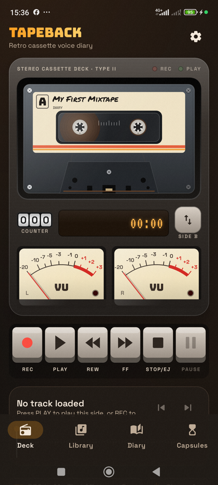
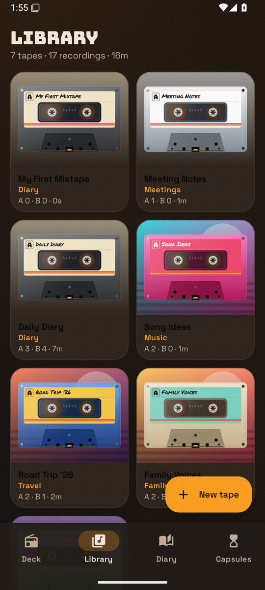
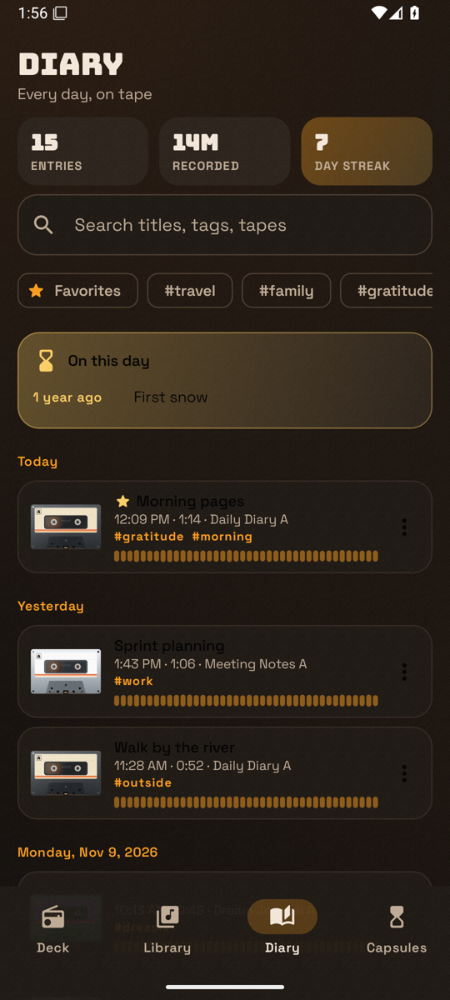
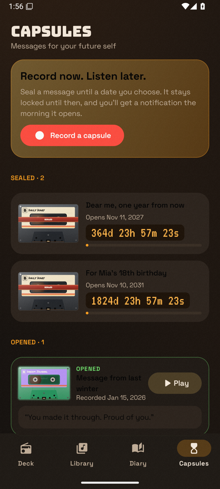
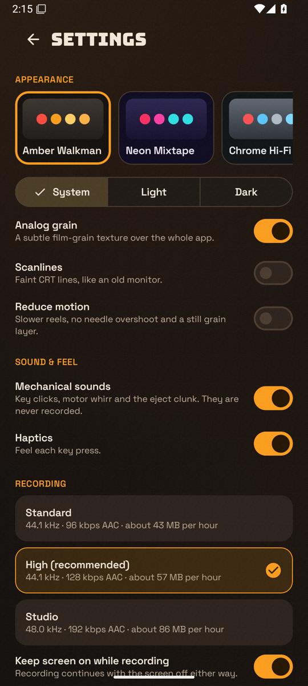

# TapeBack – Retro Cassette Voice Diary

**Press REC on your memories.** TapeBack turns an Android phone into a 1980s–1990s portable
cassette recorder: record voice notes onto virtual cassettes, play them back on a deck with
spinning reels and real VU meters, keep an audio diary, and seal messages for your future self.

Everything stays on the device. The app has no INTERNET permission, no account, no analytics
and no cloud backup.

Publisher: **F7 Developer** · Hackathon category: **Kiroween – Resurrection**

| Deck | Library | Diary | Capsules | Settings |
|---|---|---|---|---|
|  |  |  |  |  |

## Kiroween – Resurrection

The portable cassette recorder is dead technology. TapeBack brings it back with the parts
people remember and none of the parts they don't:

| What we resurrected | How it works today |
|---|---|
| Spinning reels that slow down and speed up as tape moves between them | Angular velocity ω = v / r from the current tape-pack radius, with motor inertia (`domain/policy/ReelPhysics.kt`) |
| Needle VU meters | Spring-damper ballistics with ~300 ms integration and a 1 s peak LED (`VuBallistics.kt`), driven by the real input or output level |
| Chunky piano keys that latch | REC, PLAY, REW, FF, STOP/EJECT and PAUSE latch like a real deck; STOP while stopped ejects |
| Tape sound | Real-time DSP in a Media3 `AudioProcessor`: Vintage Cassette (wow & flutter, warmth, saturation), Lo-Fi, AM Radio, adjustable hiss, 0.5×–2× speed with optional tape-style pitch |
| Mechanical clicks and motor whirr | Synthesized in code (no audio assets), rendered once to WAV and played through `SoundPool`; never captured in a recording |
| A shelf of mixtapes | Cassettes with Side A/B, hand-written labels, seven shell skins, categories and cover art |

A longer write-up of the category fit is in [docs/RESURRECTION.md](docs/RESURRECTION.md).

The modern half is what makes it trustworthy: AAC recording in a `microphone` foreground service
that survives the screen turning off, background playback with a media notification, a searchable
diary with streaks and "On this day", and time capsules unlocked by WorkManager notifications
that survive reboots.

## Features

- **Recording** – Standard, High (default) and Studio AAC presets; pause/resume into the same
  file; notification with Pause and Stop; storage check before starting; live waveform.
- **Deck playback** – waveform scrubbing, 3-digit tape counter, elapsed/total LCD, REW/FF winding,
  side flip, lock-screen controls, audio focus and headphone-unplug handling.
- **Library** – create, edit and delete cassettes; play a whole side; record onto a chosen side;
  rename, favorite, tag, move, share, save to device or delete recordings.
- **Diary** – grouped by day (Today / Yesterday / date), search over titles, tags and cassette
  names, favorite and tag filters, entry count, total time and daily streak.
- **Time capsules** – seal a recording until 1 month, 6 months, 1 year, 5 years or a custom date,
  with an optional note and a live countdown; break the seal early only after confirming.
- **Look and feel** – five themes (Amber Walkman, Neon Mixtape, Chrome Hi-Fi, Kiroween,
  Beige Classic), each light and dark; optional grain and scanlines; Reduce motion; haptics;
  bottom bar on phones and navigation rail with a two-pane deck on tablets.

## Build

Requirements: JDK 17, Android SDK 36. Commands run from the repo root in PowerShell.

| Task | Command |
|---|---|
| Debug APK | `./gradlew assembleDebug` |
| JVM unit tests | `./gradlew testDebugUnitTest` |
| Lint | `./gradlew lintDebug` |
| Instrumented tests (device attached) | `./gradlew connectedDebugAndroidTest` |
| Release APK + AAB | `./gradlew assembleRelease bundleRelease` |
| Quality gate (guards + tests, `-Full` adds lint + assemble) | `./scripts/kiro/quality-gate.ps1 -Fast` |

Release signing reads `keystore.properties` (git-ignored) with `storeFile`, `storePassword`,
`keyAlias` and `keyPassword`. Without it, the release build is produced unsigned.

## Architecture

Single `:app` module, Kotlin 2.1 + Jetpack Compose (Material 3), layered by package:

```
domain/   pure Kotlin models and policies (reel physics, VU ballistics, capsule rules, diary logic)
data/     Room database, DAOs, repositories, DataStore settings
audio/    record (MediaRecorder + foreground service), play (Media3 MediaSessionService),
          fx (pure-Kotlin DSP chain + AudioProcessor adapter), export
capsule/  WorkManager unlock scheduling
ui/       theme, Canvas components (cassette, VU meter, keys, waveform), one screen + ViewModel per feature
di/       AppContainer, manual constructor injection
```

The full requirements, design and task plan are in
[`.kiro/specs/tapeback-voice-diary/`](.kiro/specs/tapeback-voice-diary/).

## Privacy

- `android.permission.INTERNET` is removed in the manifest with `tools:node="remove"`; a Kiro
  hook fails the build check if any change brings it back.
- Recordings, covers, the database and settings live in app-private storage and are excluded
  from cloud backup.
- Permissions: microphone (recording), notifications (recording controls and capsule unlocks),
  foreground service types `microphone` and `mediaPlayback`.

## How Kiro was used

See [docs/KIRO.md](docs/KIRO.md) for the spec, steering files and hooks that drove development,
and [docs/DEMO.md](docs/DEMO.md) for the demo script and how to seed demo content.

## License

TapeBack is released under the MIT License. See [LICENSE](LICENSE).

Bundled fonts: Bungee, Space Grotesk and VT323 (SIL Open Font License), Permanent Marker
(Apache 2.0). License texts are in [docs/licenses](docs/licenses).
